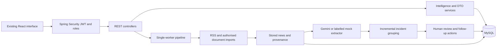
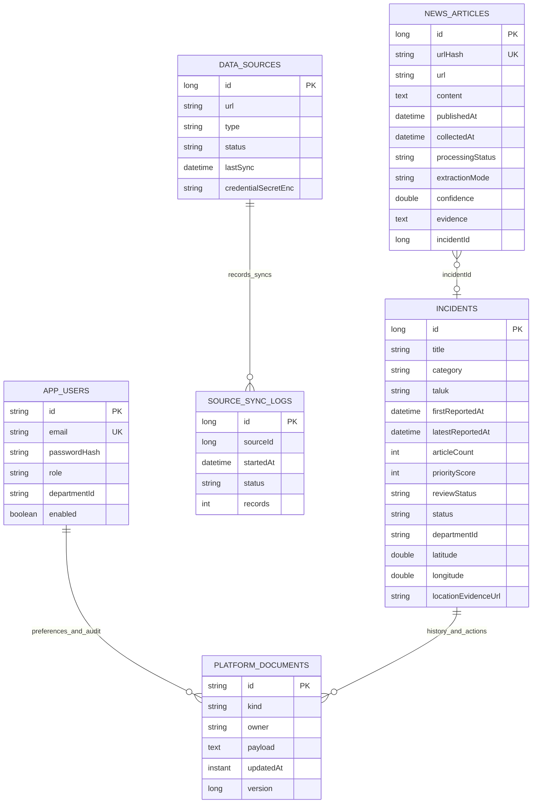

# Architecture

The existing frontend consumes typed DTOs through Axios services. Live mode consistently uses the Spring backend rather than selectively combining real and fictional district records. Optional demo mode remains isolated.

## Persistence

`news_articles.urlHash` has a unique index. Source logs use their repository's source/time query. The document table has a `(kind, owner)` index and optimistic version column. Entities are JPA-generated; inspect `backend/src/main/java` for exact column lengths and SQL types.

Actions/comments, dashboard preferences, sector snapshots, audit events and job results use versioned JSON documents for this solo-developer implementation. They are not separate fully normalised SQL tables. Department and role identifiers are validated code-defined reference values. `incidentId` and `sourceId` are logical references rather than database-enforced foreign keys in the inherited schema. A future reviewed migration should normalise high-volume action/comment/audit data and add foreign keys after validating existing records.

## News intelligence

1. Approved RSS URLs are fetched with size/time limits and no redirects. Items without valid dates, outside 30 days or in the future are excluded.
2. Exact URLs are deduplicated with SHA-256 and a unique database constraint.
3. Title + feed snippet or authorised imported text goes through structured extraction. Evidence must be a substring of the input. Location names must be configured taluks/text-supported localities. Gemini summaries remain unverified until human review.
4. New processed reports are linked incrementally. Category and known taluk must agree; unknown locations require identical normalised titles. Jaccard title similarity threshold is 0.65 and grouping spans at most roughly three days from the first report. This conservative heuristic still requires manual review; it is not semantic entity resolution.
5. Priorities are deterministic: severity, number of reports and recency, with a stored explanation. Statistics are computed from records.
6. Trend comparisons describe observed reporting counts, not causal conclusions or forecasts. Repeated articles about one incident are not counted as repeated events.

Human review and locations survive regrouping because existing incidents are retained. Scheduling is opt-in. Worker/job state is stored, but in-flight work is not resumed automatically after a server crash; NEW records can be queued again and FAILED records retried.

## Security limits

JWTs expire after one hour. Backend role and departmental scope checks protect records. CORS is a browser policy, not authentication. Source credentials use AES-GCM with a configured key; they are never in response DTOs. Imported leave requests are discarded; only aggregate totals/summaries are exposed. Login throttling and pipeline serialization are process-local. There is no MFA, distributed rate limiter, email service or public registration in this implementation.
